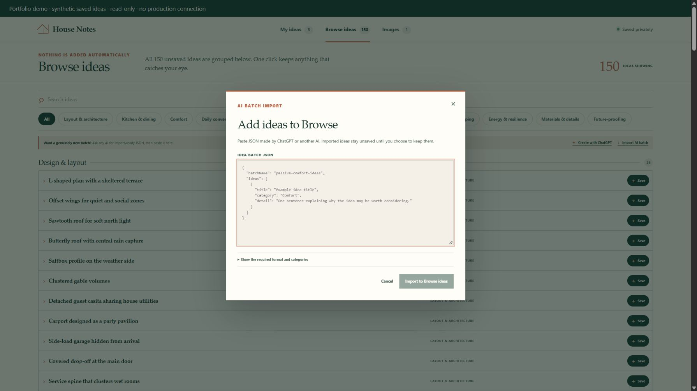

# House Notes

**A home-design notebook for turning scattered inspiration and AI brainstorms into ideas I can find, review and deliberately choose to keep.**

I wanted a place to collect possibilities for a future home with the context that makes them useful later: what the idea is, where it belongs and why it matters. House Notes organizes that material and keeps a pool of suggestions separate from the collection I have chosen.

AI can supply a large structured brainstorm through the JSON import. Every suggestion enters **Browse ideas** as an unsaved candidate; saving it to **My ideas** remains a human choice. The public demo lets you explore that workflow with synthetic examples and temporary browser-memory changes.

## Public demo

[Open the live demo](https://kobin-ai-portfolio.kobinkempe.chatgpt.site/house-notes/) · [Read the case study](https://kobin-ai-portfolio.kobinkempe.chatgpt.site/case-studies/house-notes/)


## Why I built it

Collecting ideas is easy; preserving context and deciding what belongs in a future home is harder. House Notes keeps a deliberate boundary between unsaved suggestions and personal decisions. AI-generated batches enter **Browse ideas** as candidates. Only a human action moves an idea into **My ideas**.

## Try the portfolio demo

Requires Node.js 22.13+ and npm.

```sh
npm ci
npm run dev:demo
```

Open http://127.0.0.1:4312. This mounts the real React interface using neutral saved examples and the source-controlled brainstorm library. API responses and changes are handled in browser memory; refresh resets the demo. No production account, API key, database or uploaded photos are needed.

## The AI workflow

1. Ask ChatGPT or another model for JSON matching [the batch contract](docs/idea-batch.example.json).
2. Paste it into **Import AI batch**.
3. The authenticated application validates categories and fields and skips duplicate titles.
4. Imported records remain candidates until explicitly saved.



The application uses an explicit handoff to an external AI. It does not embed a model API or automatically transmit the private notebook to a model.

## Architecture and engineering decisions

- React 19 and TypeScript; vinext/Vite; Worker-compatible server output.
- SQL records in D1 through Drizzle; uploaded image bytes in R2.
- Owner authorization on the page and every data API, including image access and batch import.
- Android web-app manifest and share target for capturing inspiration.
- `INSERT OR IGNORE` seed insertion preserves existing records.

The portfolio copy replaces the owner email and site origin with reserved example values. The isolated demo lives in `demo/`; the authenticated app remains in `app/`. See [HANDOFF.md](HANDOFF.md) before adapting it to a host. Request headers are trusted only behind the intended authenticated hosting boundary; this is not a standalone authentication service.

## Verify

```sh
npm test
npm run lint
```

The build and nine existing tests cover rendering, owner access, protected routes, share metadata and the import contract. Lint currently has two image-optimization warnings and no errors. Persistent notebook behavior requires the intended D1/R2 environment; the browser-only demo does not verify those integrations.

## Portfolio scope

Product design, a reviewable AI-to-application contract, access control, persistence boundaries, and responsive UI. Built with AI assistance; this repository does not claim model training or evaluated model accuracy. Production notes, links, uploads, environment files and deployment identifiers are excluded. [Publication review](PUBLICATION_REVIEW.md).
